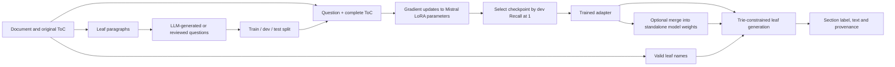

# Architecture

## Corpus and labels

A document stores ordered sections, parent links, original titles, direct text, and source
locations. Markdown headings or PDF bookmarks supply the structure. Parent text is preserved
in the artifact but no invented retrieval leaves are added. Only leaves are model targets.
Numbered ToC labels disambiguate repeated titles. Existing numeric labels are retained; if
absent, hierarchy-based numbers are assigned. Paths/IDs remain API metadata, not predictions.
JSON corpus schema 2 also reads schema 1; model schema 2 rejects older generation formats.

Markdown ingestion covers ATX/Setext headings and fenced code, not full CommonMark semantics.
PDFs without bookmarks fall back to pages. Shared-page bookmarks can overlap, multicolumn
reading order can be imperfect, and OCR is not included. Source preparation is an explicit
quality-control step. Corpus updates are atomic JSON replacements with one writer; no
concurrent-writer database or large distributed corpus index is implemented.

## What changes the model

`ingest` produces a corpus snapshot. `generate-queries` creates annotations. Neither changes
model weights. `fit`/`train` performs a forward loss, backward pass, gradient accumulation,
clipping, and AdamW steps. The complete ToC and question form the prefix; only the leaf name
and EOS contribute to loss. Prepared records are validated against the current corpus,
expected task/prompt, and train/dev split before learning. Dev queries only run in inference
mode. There is no test-set checkpoint selection or extra raw-passage training task.

LoRA freezes base weights and learns adapter matrices; full-weight mode explicitly opts out
of LoRA. Trainable parameter counts, optimizer steps, and bounded sampled-weight signatures
are recorded. Signatures are diagnostics, not checksums of every model weight. Tests also
compare actual saved tensors and merged base weights independently of those signatures.

Each epoch computes dev Recall@1 using constrained retrieval. An improvement saves the model;
a tie consumes patience. The returned artifact is the best checkpoint, not merely the final
epoch. The manifest records history and the best epoch. Input and output budgets are checked
independently, including model positional limits; silent truncation is not used.

The original recipe's Mistral/Mixtral sizes and long contexts require substantial memory.
CUDA bfloat16 and activation checkpointing reduce memory. CPU and MPS are supported for
compatible model sizes. There is no quantization, distributed training, optimizer resume,
continuous model editing, or automatic cross-document routing.

## Artifacts and inference

A run contains a safetensors adapter or full model, tokenizer, `document.json`, and
`open_stair.json`. The source snapshot supplies the ToC, valid labels, and text returned after
retrieval. Its body is not included in the inference prompt or searched by the neural path.
The trained parameters score and generate the leaf name; a trie admits only existing leaf
token sequences followed by EOS. Output tokens map exactly to leaf entries. Invalid or
unfinished generation fails explicitly. A valid label does not guarantee a relevant result.
No relevance threshold or out-of-domain abstention is implemented.

`STAIR.from_pretrained` loads a run. Adapters need their original base model (remote revision
is pinned where available); `save_pretrained(..., merge_adapter=True)` applies learned deltas
and exports a self-contained full model. This changes the current loaded object's model to
its merged form. Model loading uses safetensors with remote Python execution disabled.

An optional current corpus is fingerprint-checked against the trained version. Updating a
source artifact alone does not refresh a trained index; retraining on the new question set
is required. Both source snapshots and learned parameters may retain private data.

## Baseline and evaluation

The BM25 implementation remains an explicit research comparison. It never substitutes for
STAIR and does not update model weights. Its section text/heading index is rebuilt in memory
on load. A default search requires trained model artifacts.

Evaluation macro-averages binary-relevance Recall@1, Recall@k, MRR@k, and nDCG@k. Invalid or
duplicate hits consume their original ranking slots with zero gain. No-result questions have
zero recall. Exact normalized query overlap across splits is rejected, but semantic leakage
requires review. The original miniature handbook is a developer example, not SearchTome.
